# TAPTAP — Tài liệu Đặc tả Sản phẩm, Thiết kế Giao diện Mobile & Kiến trúc Kỹ thuật

> **Product Tagline:** `TAPTAP • Tap. Explore. Collect.`  
> **Phiên bản:** `v1.0 — Production Pilot Ready`  
> **Cập nhật lần cuối:** Thứ Ba, 27/10/2026 (GMT+7 — Giờ Việt Nam)  
> **Đơn vị phát triển:** **HOWLSLAB**  
> **Điểm đến thí điểm (Pilot Venue):** Thảo Cầm Viên Sài Gòn (*Saigon Zoo & Botanical Gardens*)  
> **Live Production App:** [https://taptap-five.vercel.app](https://taptap-five.vercel.app)  
> **GitHub Repository:** [https://github.com/PNCTriet/taptap](https://github.com/PNCTriet/taptap)  
> **Dedicated Supabase Project:** `TAPTAP` (`dfvkhtheqcsjfbfihzrk` — Region `ap-southeast-1` Singapore)

---

## Mục lục (Table of Contents)

1. [Tổng quan Điều hành (Executive Summary)](#1-tổng-quan-điều-hành-executive-summary)
2. [Tầm nhìn Sản phẩm & Hành trình Trải nghiệm Người dùng (User Journey)](#2-tầm-nhìn-sản-phẩm--hành-trình-trải-nghiệm-người-dùng-user-journey)
3. [Bộ Giao diện Mobile Thực tế Toàn diện (Full Mobile UI Visual Showcase)](#3-bộ-giao-diện-mobile-thực-tế-toàn-diện-full-mobile-ui-visual-showcase)
   - [3.1. Khám phá & Trang chủ Song ngữ (Discover & Bilingual Home)](#31-khám-phá--trang-chủ-song-ngữ-discover--bilingual-home)
   - [3.2. Bản đồ Định vị GPS Google Maps & Giả lập Đi bộ (Live GPS Map & Demo Walk)](#32-bản-đồ-định-vị-gps-google-maps--giả-lập-đi-bộ-live-gps-map--demo-walk)
   - [3.3. Chi tiết Hành trình & Trạm Chạm NFC/QR (Collection & Station NFC Landing)](#33-chi-tiết-hành-trình--trạm-chạm-nfcqr-collection--station-nfc-landing)
   - [3.4. Đóng dấu Hộ chiếu Số & Đổi Quà Voucher (Passport & Reward Redemption)](#34-đóng-dấu-hộ-chiếu-số--đổi-quà-voucher-passport--reward-redemption)
   - [3.5. Hồ sơ Đồng bộ Cloud & Trung tâm Quản trị (Profile & Admin Console)](#35-hồ-sơ-đồng-bộ-cloud--trung-tâm-quản-trị-profile--admin-console)
4. [Hệ thống Thiết kế Playful Explorer & Chuẩn Apple HIG (Design System & Mobile Ergonomics)](#4-hệ-thống-thiết-kế-playful-explorer--chuẩn-apple-hig-design-system--mobile-ergonomics)
5. [Kiến trúc Hệ thống & Công nghệ (System Architecture & Tech Stack)](#5-kiến-trúc-hệ-thống--công-nghệ-system-architecture--tech-stack)
6. [Cơ sở Dữ liệu PostgreSQL, Bảo mật RLS & Atomic RPCs (Database & Security)](#6-cơ-sở-dữ-liệu-postgresql-bảo-mật-rls--atomic-rpcs-database--security)
7. [Cấu hình Thí điểm Thảo Cầm Viên Sài Gòn (Saigon Zoo Pilot Configuration)](#7-cấu-hình-thí-điểm-thảo-cầm-viên-sài-gòn-saigon-zoo-pilot-configuration)
8. [Tiến độ Thực hiện & Lộ trình Mở rộng (Project Progress & Roadmap)](#8-tiến-độ-thực-hiện--lộ-trình-mở-rộng-project-progress--roadmap)

---

## 1. Tổng quan Điều hành (Executive Summary)

**TAPTAP** là nền tảng thu thập con dấu kỹ thuật số (Digital Stamp Rally & Interactive Passport) kết hợp giữa **điểm chạm vật lý tại điểm đến (Physical NFC Tags / QR Codes)** và **trải nghiệm ứng dụng web di động tức thì (Zero-App-Install Mobile Web Experience)**.

Thay vì yêu cầu du khách tải ứng dụng nặng nề tại cổng soát vé, **TAPTAP** cho phép khách tham quan chỉ cần đưa điện thoại (iPhone hoặc Android) chạm nhẹ vào thẻ **NFC** hoặc quét mã **QR** đặt tại từng khu vực tham quan để mở ngay giao diện trạm trên trình duyệt, đóng dấu vào **Hộ chiếu Khám phá (Explorer Passport)**, xem bản đồ định vị **Google Maps GPS** trực tiếp, và mở khóa phần thưởng lưu niệm tại quầy dịch vụ.

| Hạng mục | Thông tin Chi tiết |
| :--- | :--- |
| **Tên sản phẩm** | **TAPTAP** (`Tap. Explore. Collect.`) |
| **Đơn vị phát triển** | **HOWLSLAB** |
| **Mô hình hoạt động** | B2B2C Interactive Venue Engagement & Digital Passport Platform |
| **Điểm đến Pilot đầu tiên** | **Thảo Cầm Viên Sài Gòn** (*Saigon Zoo & Botanical Gardens*) — Quận 1, TP. Hồ Chí Minh |
| **Bộ sưu tập Pilot** | **Zoo Explorer** (4 trạm NFC thực tế + 1 Huy hiệu + 1 Voucher quà tặng tại Cổng Chính) |
| **Ngôn ngữ hỗ trợ** | Song ngữ tức thì **Tiếng Việt (`VI`)** & **Tiếng Anh (`EN`)** |
| **Trạng thái triển khai** | **Production Pilot Ready (`v1.0`)** — Đã vận hành live trên Vercel + Supabase Cloud |

---

## 2. Tầm nhìn Sản phẩm & Hành trình Trải nghiệm Người dùng (User Journey)

Hành trình của một khách tham quan (gia đình, trẻ em, nhóm bạn trẻ, khách du lịch quốc tế) tại Thảo Cầm Viên Sài Gòn được tối ưu hóa để đạt **thời gian phản hồi dưới 2 giây** kể từ lúc chạm thẻ vật lý:

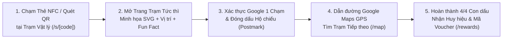

1. **Điểm chạm vật lý (Physical Touchpoint):** Khách tham quan bắt gặp bảng trạm TAPTAP tại *Voi Châu Á*, *Nhà Kính Thực Vật*, *Hồ Hồng Hạc*, hoặc *Đài Ngắm Hươu Cao Cổ*. Chạm điện thoại vào chip NFC (hoặc quét mã QR dự phòng) sẽ dẫn thẳng tới URL định danh duy nhất `/s/{public_code}`.
2. **Nhận diện & Tương tác tức thì (Instant Station Sheet):** Trang trạm hiển thị minh họa vector độc quyền của loài thú/cảnh quan, khoảng cách GPS thực tế tính bằng mét (`m`), gợi ý vị trí, và nút hành động nổi bật.
3. **Đồng bộ Tài khoản & Đóng dấu Bất biến (1-Tap Google Auth & Stamp Seal):** Người dùng đăng nhập nhanh bằng tài khoản Google (`Continue with Google` — chuẩn OAuth 2.0 PKCE) để đóng dấu. Dấu mộc bưu điện (`STAMPED`) đóng xuống thẻ cùng hiệu ứng ăn mừng và lưu vĩnh viễn trên đám mây.
4. **Định vị & Dẫn đường Nội khu (Live GPS Map & Trail Navigation):** Chuyển sang tab **Bản đồ (`/map`)** để xem vị trí hiện tại bằng chấm xanh radar trên nền bản đồ **Google Maps chính thức** (chế độ *Bản đồ* hoặc *Vệ tinh*), theo dõi đường mòn gợi ý nối 4 trạm, hoặc bấm **Chỉ đường** để mở dẫn đường đi bộ.
5. **Mở khóa Huy hiệu & Đổi quà tại Cổng Chính (Reward Voucher Redemption):** Khi sưu tầm đủ `4 / 4` con dấu, hệ thống tự động cấp huy hiệu **Zoo Explorer Crest** và mở khóa phần thưởng **Bộ Bưu Thiếp & Sticker**, sinh mã voucher định danh (ví dụ: `ZOO-TCV2026`) để xuất trình tại Quầy Cổng Chính (08:30–17:00).

---

## 3. Bộ Giao diện Mobile Thực tế Toàn diện (Full Mobile UI Visual Showcase)

Toàn bộ giao diện dưới đây được chụp trực tiếp từ bản Production (`https://taptap-five.vercel.app`) trên khung nhìn chuẩn **iPhone 15 Pro (`390 × 844 px`, Retina `@2x`)**, giữ nguyên tỷ lệ khung hình dọc tự nhiên của thiết bị di động.

---

### 3.1. Khám phá & Trang chủ Song ngữ (Discover & Bilingual Home)

Trang chủ (`/`) đóng vai trò là trung tâm điều hướng cực kỳ gọn gàng: hiển thị bộ sưu tập **Zoo Explorer**, thanh tiến độ tổng quan, bản đồ GPS thu nhỏ của Thảo Cầm Viên và danh sách 4 trạm dừng. Người dùng có thể chuyển đổi ngôn ngữ **EN / VI** tức thì ở góc trên bên phải mà không cần tải lại trang.

| **01. Trang chủ Khám phá — Tiếng Anh (`EN`)** | **02. Trang chủ Khám phá — Tiếng Việt (`VI`)** |
| :---: | :---: |
| 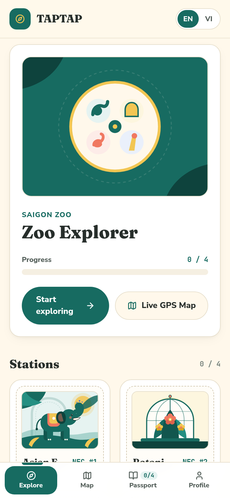 | 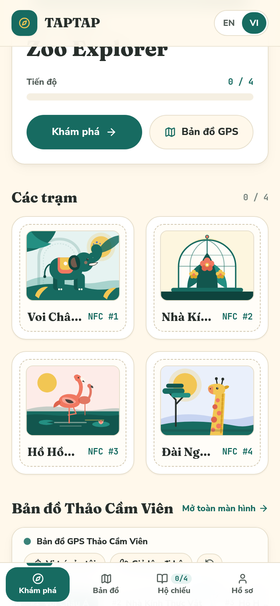 |
| **Route:** `/` (`locale = "en"`) Hiển thị thẻ chiến dịch *Zoo Explorer*, tiến độ `0 / 4`, hai nút hành động chính (*Start exploring*, *Live GPS Map*) và lưới các trạm NFC. | **Route:** `/` (`locale = "vi"`) Giao diện chuyển sang Tiếng Việt đồng bộ 100%, tích hợp khung **Bản đồ GPS Thảo Cầm Viên** trực tiếp ngay trên trang chủ. |

**Điểm nhấn UI/UX & Kỹ thuật:**
- **Paper Card Surface (`#FFFDF7` trên nền `#FFF8EB`):** Tạo cảm giác ấm áp như một cuốn sổ tay hành trình thực thụ dưới ánh nắng ngoài trời, độ tương phản chữ đạt chuẩn **WCAG AA (`11.8:1`)**.
- **2-Tier Sticky Navigation:** Thanh Header trên cùng giữ thương hiệu `TAPTAP` + nút chuyển ngôn ngữ `EN/VI`; thanh Bottom Navigation cố định dưới đáy màn hình với 4 tab chính (*Khám phá*, *Bản đồ*, *Hộ chiếu*, *Hồ sơ*) kèm badge đếm số con dấu thời gian thực.

---

### 3.2. Bản đồ Định vị GPS Google Maps & Giả lập Đi bộ (Live GPS Map & Demo Walk)

Trang **Bản đồ (`/map`)** cung cấp trải nghiệm định vị thực địa sắc nét bằng nguồn tile **Google Maps chính thức** (`mt0–mt3.google.com/vt/lyrs=m` & `lyrs=y`) kết hợp hệ thống pin SVG đồng bộ cho từng trạm thú và ngăn kéo thông tin trạm (Bottom Station Sheet).

| **03. Bản đồ GPS Google Maps — Chế độ Bản đồ (`Roadmap`)** | **04. Bản đồ GPS Vệ tinh & Giả lập Đi bộ (`Satellite + Demo Walk`)** |
| :---: | :---: |
| 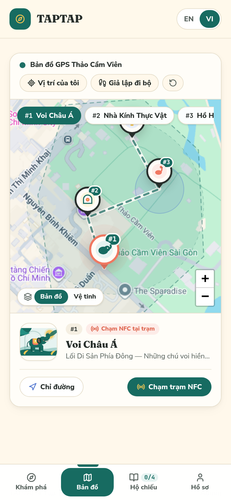 | 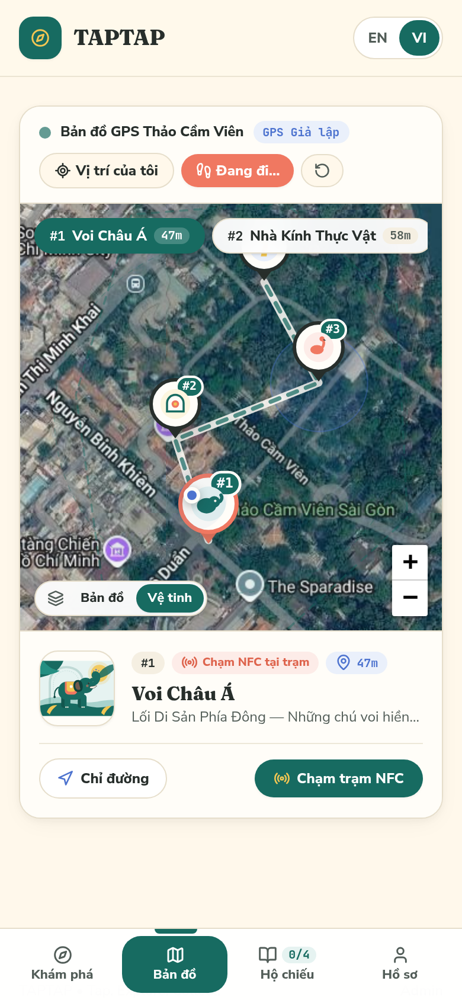 |
| **Route:** `/map` (`Roadmap View`) Hiển thị khuôn viên Thảo Cầm Viên Sài Gòn, đường mòn nối 4 trạm, các pin `#1 Voi Châu Á`, `#2 Nhà Kính Thực Vật`, `#3 Hồ Hồng Hạc` và thẻ chi tiết trạm bên dưới. | **Route:** `/map` (`Satellite View + Demo Walk Active`) Chế độ ảnh chụp vệ tinh kết hợp tính năng **Giả lập đi bộ (Demo Walk)**: hiển thị chấm xanh GPS của người dùng và khoảng cách thực tế (`47m`, `58m`) tới từng trạm. |

**Điểm nhấn UI/UX & Kỹ thuật:**
- **Định vị 2 Tầng (2-Tier Geolocation Fallback):** Tự động yêu cầu GPS độ chính xác cao (`enableHighAccuracy: true`) trên thiết bị di động và chuyển mượt mà sang định vị Wi-Fi (`enableHighAccuracy: false`) trên macOS/iPadOS hoặc khu vực rợp bóng cây mà không báo lỗi giả.
- **Chế độ Giả lập Đi bộ (`Demo Walk`):** Cho phép đội ngũ vận hành và đối tác kiểm thử toàn bộ luồng di chuyển dọc đường mòn Thảo Cầm Viên từ xa, tự động tính khoảng cách Haversine (`47m`) và cập nhật trạng thái khoảng cách theo thời gian thực.

---

### 3.3. Chi tiết Hành trình & Trạm Chạm NFC/QR (Collection & Station NFC Landing)

Khi khách tham quan bấm vào bộ sưu tập hoặc chạm điện thoại vào thẻ NFC tại trạm (ví dụ `/s/tcv-k9x2m4p8` — *Voi Châu Á*), hệ thống mở ra giao diện chi tiết với hình minh họa vector đa lớp và trạng thái xác thực rõ ràng.

| **05. Trang Chi tiết Bộ sưu tập (`Zoo Explorer`)** | **06. Trang Đích Khi Chạm Thẻ NFC (Chưa đóng dấu)** |
| :---: | :---: |
| 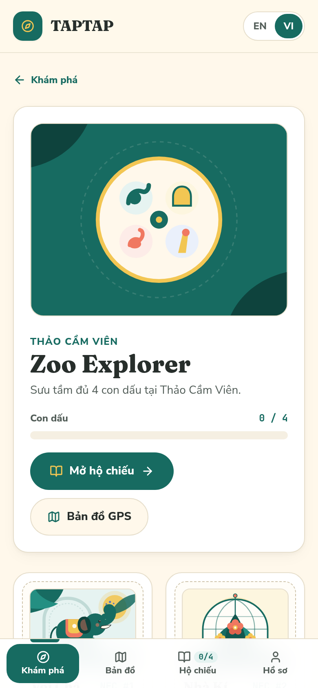 | 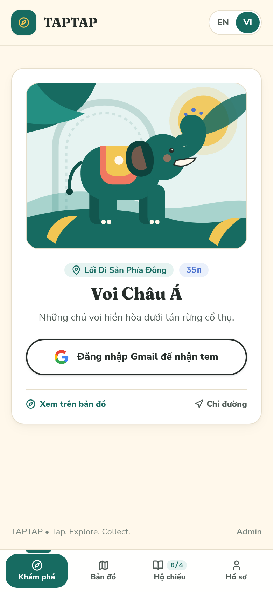 |
| **Route:** `/collections/zoo-explorer` Tổng hợp tiến độ sưu tầm của hành trình 4 trạm, danh sách từng trạm kèm khoảng cách định vị và thông tin phần thưởng khi hoàn thành. | **Route:** `/s/tcv-k9x2m4p8` (*Asian Elephant — NFC #1*) Giao diện xuất hiện ngay khi chạm thẻ NFC: hiển thị minh họa Voi Châu Á, gợi ý vị trí *East Heritage Path*, khoảng cách `11m` và nút xác thực Google để nhận dấu. |

**Điểm nhấn UI/UX & Kỹ thuật:**
- **Cơ chế Bảo vệ Chống Gian lận & Đồng bộ Đám mây:** Việc thu thập con dấu tại `/s/[code]` được bảo vệ qua xác thực tài khoản Google (`Continue with Google to collect`), giúp mỗi con dấu gắn chặt với định danh người dùng trên Supabase PostgreSQL, không bị mất khi xóa bộ nhớ trình duyệt hoặc đổi điện thoại.
- **Hỗ trợ Alias Code & Thẻ Bị Vô hiệu hóa:** Định tuyến `/s/[code]` nhận diện cả mã chính thức (`tcv-k9x2m4p8`), mã dự phòng tương thích ngược (`tcv-q7w3n5r2`, ...) và hiển thị thông báo thân thiện nếu thẻ vật lý đang tạm ngưng bảo trì (`tcv-disabled99`).

---

### 3.4. Đóng dấu Hộ chiếu Số & Đổi Quà Voucher (Passport & Reward Redemption)

Ngay sau khi đóng dấu thành công, người dùng nhận được dấu mộc bưu điện (`✓ STAMPED`) trên thẻ trạm, theo dõi trọn bộ sưu tập `4 / 4 con dấu` trong **Hộ chiếu (`/passport`)**, và nhận mã đổi quà tại trang **Phần thưởng (`/rewards/[id]`)**.

| **07. Trạm NFC Sau Khi Đóng Dấu (`STAMPED` Seal)** | **08. Hộ chiếu Cá nhân Đã Sưu tầm Đủ `4/4` Con dấu** |
| :---: | :---: |
| 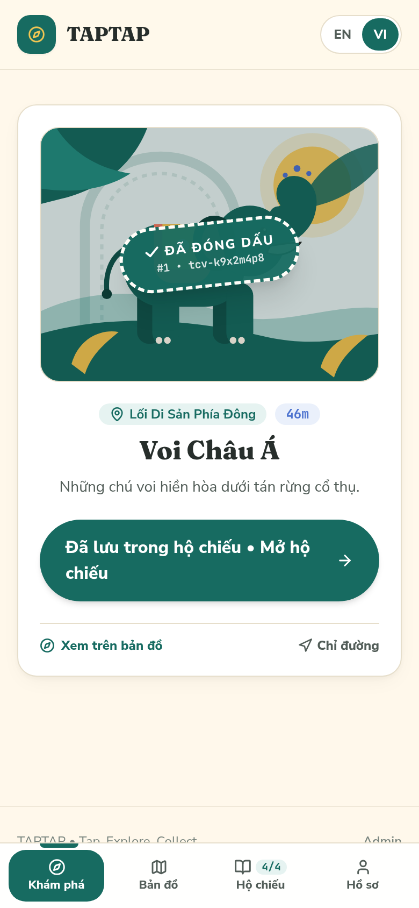 | 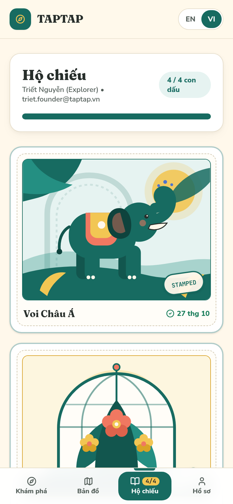 |
| **Route:** `/s/tcv-k9x2m4p8` (Trạng thái đã đóng dấu) Hiển thị con dấu mộc `✓ STAMPED` kèm mã định danh `#1 • tcv-k9x2m4p8`, nút chuyển thẳng sang Hộ chiếu và badge tiến độ cập nhật dưới thanh điều hướng. | **Route:** `/passport` (Đã đồng bộ tài khoản Explorer) Hiển thị tên & email người dùng (`Triết Nguyễn • triet.founder@taptap.vn`), thanh tiến độ đạt `4 / 4 con dấu` (100%) và các thẻ con dấu đóng mộc kèm ngày thu thập (`27 thg 10`). |

| **09. Trang Đổi Quà & Mã Voucher (`ZOO-TCV2026`)** | **10. Trang Hồ sơ & Đồng bộ Tài khoản Google (`/profile`)** |
| :---: | :---: |
| 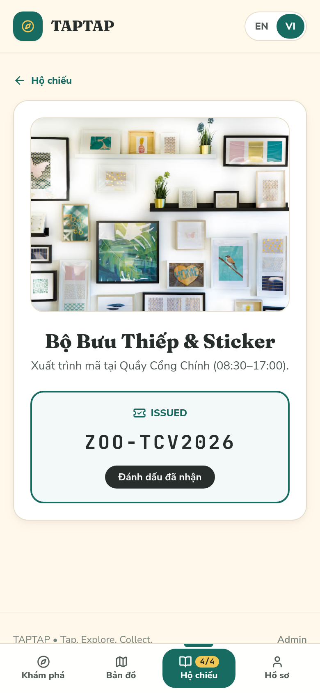 | 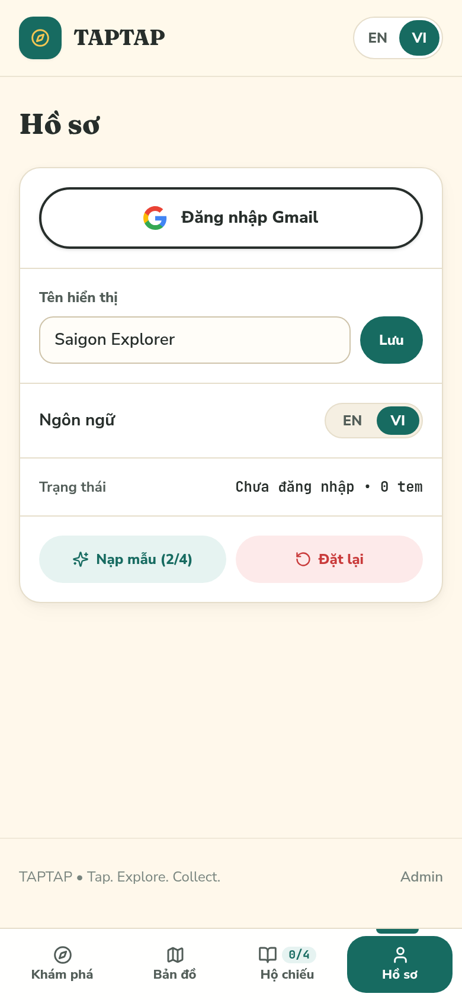 |
| **Route:** `/rewards/77777777-7777-4777-8777-777777777701` Khi đạt đủ `4/4` con dấu, phần thưởng **Bộ Bưu Thiếp & Sticker** được mở khóa kèm mã voucher monospace **`ZOO-TCV2026`** (trạng thái `ISSUED`) để xuất trình tại Quầy Cổng Chính. | **Route:** `/profile` Quản lý hồ sơ người khám phá, đăng nhập/đồng bộ Google OAuth 1 chạm, chuyển đổi ngôn ngữ giao diện (`English` / `Tiếng Việt`) và xem thống kê nhanh số con dấu & phần thưởng. |

---

### 3.5. Hồ sơ Đồng bộ Cloud & Trung tâm Quản trị (Profile & Admin Console)

Bên cạnh giao diện dành cho khách tham quan, **TAPTAP** tích hợp sẵn phân hệ **Quản trị Vận hành (`/admin`)** tối ưu hoàn toàn trên thiết bị di động, giúp đội ngũ vận hành tại Thảo Cầm Viên theo dõi chỉ số KPI trực tiếp tại hiện trường, sao chép đường dẫn ghi thẻ NFC và tải mã QR chuẩn vector (`SVG`) để in ấn.

| **11. Bảng Điều khiển Quản trị Tổng quan (`/admin`)** | **12. Quản lý Trạm, Link NFC & Mã QR (`/admin/stations`)** |
| :---: | :---: |
| 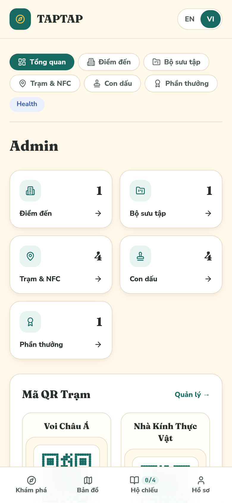 | 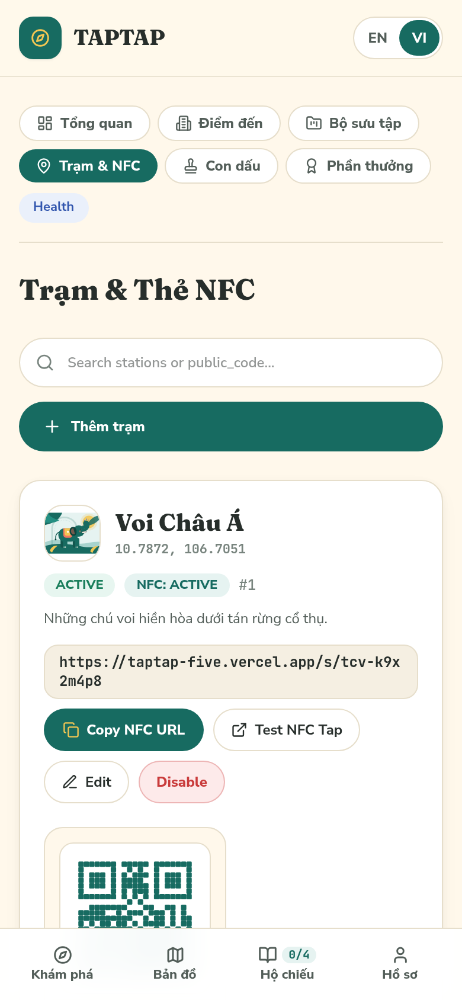 |
| **Route:** `/admin` Hiển thị các thẻ KPI tổng quan (*Điểm đến*, *Bộ sưu tập*, *Trạm & Thẻ NFC*, *Lượt đóng dấu*, *Phần thưởng*), thanh điều hướng nhanh tới 6 phân hệ quản trị và danh sách đường dẫn NFC trực tiếp. | **Route:** `/admin/stations` Quản lý chi tiết từng trạm: trạng thái hoạt động (`ACTIVE` / `NFC: ACTIVE`), tọa độ GPS, hộp sao chép URL NFC vật lý (`Copy NFC URL`), nút kiểm thử nhanh (`Test NFC Tap`) và mã QR SVG tích hợp sẵn. |

---

## 4. Hệ thống Thiết kế Playful Explorer & Chuẩn Apple HIG (Design System & Mobile Ergonomics)

Giao diện của **TAPTAP** được thiết kế theo ngôn ngữ **"Playful Explorer"** — kết hợp cảm hứng từ những cuốn sổ hộ chiếu du lịch cổ điển, bộ tem bưu chính Đông Dương và tiêu chuẩn công thái học di động hiện đại (**Apple Human Interface Guidelines** & **Material Design 3**).

### 4.1. Bảng màu Thương hiệu & Độ tương phản Ngoài trời (Color Palette)

Vì người dùng sử dụng ứng dụng dưới ánh nắng tự nhiên tại Thảo Cầm Viên, bảng màu loại bỏ hoàn toàn các mảng xám mờ nhạt và sử dụng nền giấy kem ấm (`Paper Cream`) kết hợp màu xanh rừng sâu (`Explorer Teal`) có độ tương phản cao:

| Tên Token | Mã Hex | Vai trò Sử dụng trong UI | Độ tương phản (WCAG) |
| :--- | :---: | :--- | :--- |
| **Explorer Teal (Primary)** | `#176B61` | Màu chủ đạo: nút bấm chính, tab đang chọn, thanh tiến độ, viền mã voucher | **6.1 : 1** trên nền trắng (Đạt chuẩn AA+) |
| **Deep Teal Hover** | `#12564E` | Trạng thái nhấn (`:active` / `:hover`) của nút hành động chính | **7.8 : 1** (Đạt chuẩn AAA) |
| **Adventure Coral (Accent)** | `#F07861` | Điểm nhấn năng lượng: huy hiệu NFC đang chờ chạm, trạng thái cảnh báo nhẹ | Nổi bật trên nền kem |
| **Sunshine Yellow** | `#F2C653` | Màu phần thưởng, biểu tượng huy hiệu hoàn thành, mặt trời trong tranh SVG | Kết hợp cùng `#272E2B` Ink |
| **Discovery Blue** | `#4D73CF` | Khoảng cách định vị GPS (`11m`, `47m`), chấm xanh bản đồ và trạm số #4 | Dễ nhận diện trên bản đồ |
| **Paper Cream (Background)** | `#FFF8EB` | Nền tổng thể của ứng dụng, giảm chói mắt khi nhìn ngoài trời nắng | Nền tiêu chuẩn |
| **Card Surface** | `#FFFDF7` | Bề mặt thẻ (`paper-card`) đi kèm viền ấm `#E6DECB` và đổ bóng mềm | Tạo chiều sâu phân lớp |
| **Charcoal Ink (Text)** | `#272E2B` | Chữ tiêu đề và nội dung chính | **11.8 : 1** (Đạt chuẩn AAA tuyệt đối) |

### 4.2. Hệ thống Typography (3 Tầng Phông chữ)

1. **Display Serif — `Fraunces` (`--font-display-serif`):** Phông chữ có chân giàu cá tính dành cho tên trạm (*Asian Elephant / Voi Châu Á*), tiêu đề Hộ chiếu và tên Bộ sưu tập, gợi cảm giác trang trọng của một cuốn cẩm nang khám phá thiên nhiên.
2. **Humanist Sans — `Nunito Sans` (`--font-sans`):** Phông chữ không chân bo tròn thân thiện dành cho toàn bộ nội dung mô tả, nút bấm, nhãn điều hướng và hướng dẫn đổi quà — hỗ trợ đầy đủ dấu Tiếng Việt rõ nét ở kích thước nhỏ.
3. **Technical Monospace — `JetBrains Mono` (`--font-mono`):** Dành riêng cho mã định danh thẻ NFC (`tcv-k9x2m4p8`), tọa độ GPS (`10.7872, 106.7051`) và mã voucher đổi thưởng (`ZOO-TCV2026`).

### 4.3. Hệ thống Minh họa Vector Đa lớp (Custom SVG Animal Artwork)

Mỗi trạm trong Thảo Cầm Viên sở hữu một bộ minh họa SVG riêng biệt (`src/components/station-artwork.tsx`) được dựng bằng các lớp hình học vector sắc nét ở mọi mật độ điểm ảnh, đồng bộ xuyên suốt từ **Thẻ Trạm trên Trang chủ**, **Pin tròn trên Bản đồ Google Maps**, **Khung Hộ chiếu**, cho tới **Trang Đích NFC**:
- **Trạm #1 (`asian-elephant`):** Chú voi Châu Á màu xanh ngọc dưới tán rừng cổ thụ và ánh mặt trời vàng.
- **Trạm #2 (`botanical-conservatory`):** Mái vòm kính cổ điển cùng hoa phong lan nhiệt đới và lá dương xỉ.
- **Trạm #3 (`flamingo-lagoon`):** Hồng hạc sắc cam san hô soi bóng bên hồ sen xanh.
- **Trạm #4 (`giraffe-lookout`):** Hươu cao cổ vươn mình giữa những tán cây keo phương Bắc.

### 4.4. Chuẩn Công thái học Cảm ứng (Touch Ergonomics & Motion)

- **Vùng chạm tối thiểu `48 × 48 px`:** Mọi nút bấm chính (*Continue with Google*, *Stamp Collected*, *Chạm trạm NFC*, *Chỉ đường*) đều có chiều cao từ `44px` đến `52px`, đặt trong vùng ngón cái (Thumb Zone) ở nửa dưới màn hình.
- **Hiệu ứng Chuyển động Có Chủ đích:**
  - `animate-stamp-pop`: Hiệu ứng lò xo (`cubic-bezier(0.22, 1, 0.36, 1)`) khi con dấu `STAMPED` vừa được đóng xuống hộ chiếu.
  - `animate-nfc-ring`: Vòng sóng lan tỏa quanh biểu tượng NFC để hướng dẫn trực quan thao tác chạm thẻ.
  - Tự động tôn trọng thiết lập `prefers-reduced-motion: reduce` của hệ điều hành iOS/Android.

---

## 5. Kiến trúc Hệ thống & Công nghệ (System Architecture & Tech Stack)

Hệ thống được thiết kế theo kiến trúc **Serverless Edge + Cloud-Native PostgreSQL** đảm bảo khả năng chịu tải cao khi hàng nghìn khách tham quan chạm thẻ NFC đồng thời vào dịp cuối tuần hoặc lễ hội:

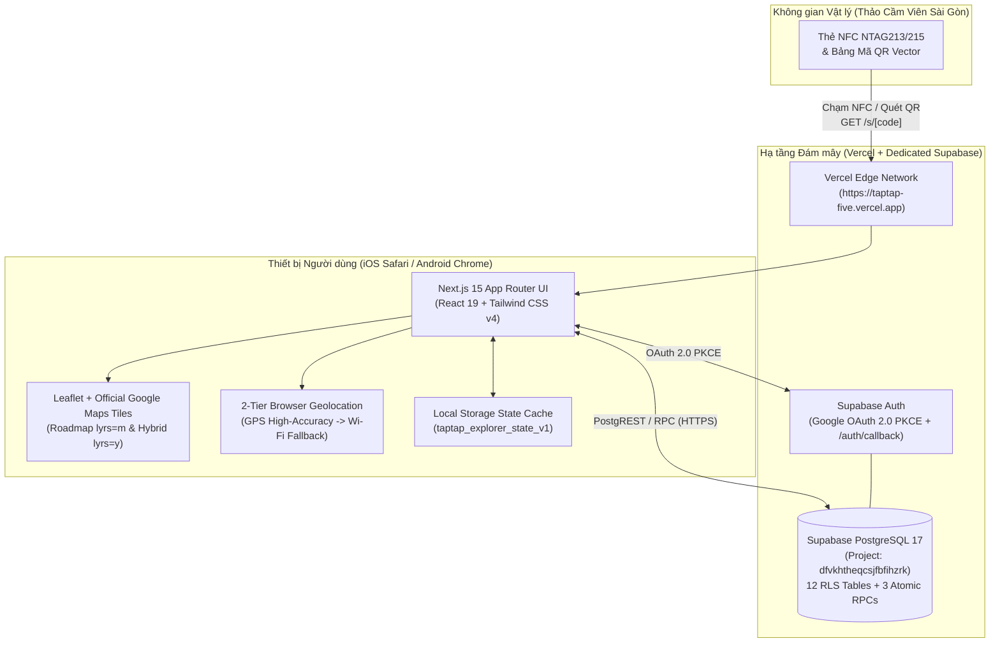

### Bảng Công nghệ Sử dụng (Tech Stack Matrix)

| Tầng Kiến trúc | Công nghệ / Thư viện | Phiên bản | Vai trò trong TAPTAP |
| :--- | :--- | :---: | :--- |
| **Application Framework** | **Next.js (App Router)** | `15.3.2` | Định tuyến App Router, Server/Client Components, SSR Auth Callback (`/auth/callback`) |
| **UI Library** | **React** | `19.1.0` | Quản lý trạng thái tương tác thời gian thực qua `ExplorerProvider` |
| **Styling & Design Tokens** | **Tailwind CSS** | `4.1.7` | Hệ thống CSS biến môi trường, thiết kế Mobile-First và hiệu ứng chuyển động |
| **Map & Geolocation Engine** | **Leaflet + Google Maps Tiles** | `1.9.4` | Hiển thị bản đồ Google Maps chính thức (Roadmap & Satellite), pin SVG tùy chỉnh, tính khoảng cách Haversine |
| **Authentication** | **Supabase Auth (`@supabase/ssr`)** | `0.6.1` | Xác thực Google OAuth 2.0 theo luồng PKCE bảo mật, tự động đồng bộ phiên qua Cookie & LocalStorage |
| **Database & Backend-as-a-Service** | **Supabase PostgreSQL** | `2.49.4` | Lưu trữ dữ liệu quan hệ với 12 bảng bật Row Level Security (RLS) và các hàm RPC nguyên tử |
| **Testing & QA** | **Vitest + Playwright** | `3.1.3` / `1.52.0` | Kiểm thử đơn vị (Unit Tests) và kiểm thử tự động đầu-cuối (E2E Smoke Suite trên Chromium) |
| **Hosting & CI/CD** | **Vercel Production** | Edge | Tự động build & triển khai từ nhánh `main` của kho mã nguồn `PNCTriet/taptap` |

---

## 6. Cơ sở Dữ liệu PostgreSQL, Bảo mật RLS & Atomic RPCs (Database & Security)

TAPTAP sử dụng một dự án **Supabase độc lập hoàn toàn** (Project Name: `TAPTAP`, Ref ID: `dfvkhtheqcsjfbfihzrk`, đặt tại cụm máy chủ **AWS `ap-southeast-1` Singapore** để có độ trễ thấp nhất về Việt Nam).

### 6.1. Sơ đồ 12 Bảng Dữ liệu Chính (Database Schema)

Toàn bộ 12 bảng trong schema `public` đều được kích hoạt **Row Level Security (`RLS Enabled = true`)**:

| STT | Tên Bảng (`public.*`) | Vai trò Nghiệp vụ | Chính sách Bảo mật RLS (Row Level Security) |
| :---: | :--- | :--- | :--- |
| 1 | `venues` | Lưu thông tin điểm đến (Thảo Cầm Viên Sài Gòn) | Public `SELECT` cho điểm đến `active`; quyền ghi giới hạn cho `venue_admins` |
| 2 | `collections` | Bộ sưu tập hành trình (*Zoo Explorer*) | Public `SELECT` cho bộ sưu tập thuộc điểm đến đang hoạt động |
| 3 | `stations` | Điểm trạm vật lý kèm tọa độ GPS (`latitude`, `longitude`) | Public `SELECT` cho trạm `active`; quản trị viên điểm đến toàn quyền CRUD |
| 4 | `nfc_tags` | Định danh thẻ NFC vật lý (`public_code`, `tag_uid`, trạng thái) | Public `SELECT` để giải mã `/s/[code]`; chống giả mạo từ phía client |
| 5 | `stamps` | Định nghĩa con dấu và màu sắc/thứ tự hiển thị | Public `SELECT`; liên kết `1-1` hoặc `N-1` với trạm và bộ sưu tập |
| 6 | `badges` | Huy hiệu danh dự khi hoàn thành bộ sưu tập | Public `SELECT`; cấp tự động khi người dùng đạt đủ số dấu yêu cầu |
| 7 | `rewards` | Phần thưởng vật lý/voucher tại điểm đến | Public `SELECT`; kiểm tra điều kiện `required_stamps` khi phát hành mã |
| 8 | `participants` | Hồ sơ người tham gia (`auth_user_id`, `email`, `display_name`) | Người dùng chỉ được đọc/cập nhật hồ sơ gắn với `auth.uid()` của chính mình |
| 9 | `collected_stamps` | Lịch sử các con dấu đã thu thập của từng người dùng | Ràng buộc duy nhất `UNIQUE(participant_id, stamp_id)` chống đóng dấu trùng lặp |
| 10 | `participant_badges` | Các huy hiệu người dùng đã đạt được | Chỉ đọc/ghi theo `participant_id` thuộc quyền sở hữu của `auth.uid()` |
| 11 | `redemptions` | Mã voucher đổi thưởng đã phát hành (`ZOO-XXXXXX`) | Ràng buộc duy nhất `UNIQUE(participant_id, reward_id)` chống nhận thưởng nhiều lần |
| 12 | `venue_admins` | Phân quyền quản trị viên theo từng điểm đến (`owner`, `editor`) | Kiểm soát quyền truy cập vào Admin Console và thao tác chỉnh sửa dữ liệu |

### 6.2. Các Hàm Giao dịch Nguyên tử (`SECURITY DEFINER` RPC Functions)

Để đảm bảo tính toàn vẹn dữ liệu tuyệt đối khi người dùng chạm thẻ NFC hoặc đổi thưởng, cơ sở dữ liệu cung cấp các hàm PostgreSQL chạy trong một giao dịch nguyên tử (Atomic Transaction):

1. **`sync_local_passport(p_display_name, p_preferred_locale, p_station_codes[])`** / **`upsert_gmail_participant(...)`**:
   - Tự động khởi tạo hoặc cập nhật hồ sơ `participants` ngay khi người dùng hoàn tất đăng nhập Google OAuth.
   - Đồng bộ toàn bộ con dấu, huy hiệu và lịch sử đổi quà của người dùng về thiết bị trong một lượt gọi duy nhất.
2. **`claim_station_stamp(p_public_code, p_verification_method, p_lat, p_lng)`**:
   - Kiểm tra tính hợp lệ và trạng thái `active` của mã thẻ NFC (`p_public_code`).
   - Ghi nhận con dấu mới vào bảng `collected_stamps` (idempotent — nếu đã thu thập trước đó sẽ trả về bản ghi hiện có mà không gây lỗi).
   - Tự động đếm tổng số con dấu trong bộ sưu tập và cấp ngay huy hiệu vào `participant_badges` nếu người dùng vừa hoàn thành trạm cuối cùng.
3. **`redeem_reward(p_reward_id)`**:
   - Xác minh người dùng đã thu thập đủ số lượng con dấu yêu cầu (`collected_count >= reward.required_stamps`).
   - Sinh mã voucher duy nhất (định dạng `ZOO-XXXXXX`) và lưu vào bảng `redemptions` với trạng thái `issued`.

---

## 7. Cấu hình Thí điểm Thảo Cầm Viên Sài Gòn (Saigon Zoo Pilot Configuration)

Dưới đây là bảng thông số cấu hình chuẩn của **4 trạm NFC thí điểm** tại **Thảo Cầm Viên Sài Gòn**, sẵn sàng để nạp trực tiếp vào thẻ NFC vật lý (`NTAG213` / `NTAG215`) hoặc in bảng mã QR đặt tại hiện trường:

| Thứ tự | Tên Trạm (VI / EN) | Khu vực Đặt Trạm | Tọa độ GPS (`Lat, Lng`) | Mã NFC Chính (`public_code`) | Mã Dự phòng (Legacy Alias) | URL Ghi Thẻ NFC Vật lý (Production) |
| :---: | :--- | :--- | :---: | :---: | :---: | :--- |
| **#1** | **Voi Châu Á** *Asian Elephant* | Lối Di Sản Phía Đông *East Heritage Path* | `10.7872, 106.7051` | `tcv-k9x2m4p8` | — | [`https://taptap-five.vercel.app/s/tcv-k9x2m4p8`](https://taptap-five.vercel.app/s/tcv-k9x2m4p8) |
| **#2** | **Nhà Kính Thực Vật** *Botanical Conservatory* | Khu Nhà Kính *Botanical Glasshouse* | `10.7881, 106.7048` | `tcv-b7n4q1w6` | `tcv-q7w3n5r2` | [`https://taptap-five.vercel.app/s/tcv-b7n4q1w6`](https://taptap-five.vercel.app/s/tcv-b7n4q1w6) |
| **#3** | **Hồ Hồng Hạc** *Flamingo Lagoon* | Hồ Trung Tâm *Central Lagoon* | `10.7886, 106.7061` | `tcv-m3p9x5r2` | `tcv-h4j8v6b1` | [`https://taptap-five.vercel.app/s/tcv-m3p9x5r2`](https://taptap-five.vercel.app/s/tcv-m3p9x5r2) |
| **#4** | **Đài Ngắm Hươu Cao Cổ** *Giraffe Lookout* | Đài Quan Sát Phía Bắc *North Savanna Deck* | `10.7895, 106.7056` | `tcv-w2v8k6j4` | `tcv-z2c9f3t7` | [`https://taptap-five.vercel.app/s/tcv-w2v8k6j4`](https://taptap-five.vercel.app/s/tcv-w2v8k6j4) |

- **Thẻ Kiểm thử Trạng thái Bảo trì / Vô hiệu hóa:** [`https://taptap-five.vercel.app/s/tcv-disabled99`](https://taptap-five.vercel.app/s/tcv-disabled99)
- **Trang Kiểm tra Sức khỏe Hệ thống (System Readiness):** [`https://taptap-five.vercel.app/health`](https://taptap-five.vercel.app/health)

---

## 8. Tiến độ Thực hiện & Lộ trình Mở rộng (Project Progress & Roadmap)

### 8.1. Các Hạng mục Đã Hoàn thành 100% (Completed Milestones)

- [x] **Giai đoạn 1 — Nền tảng Cốt lõi & Luồng Sản phẩm (Core Foundation):**
  - Xây dựng hoàn chỉnh kiến trúc Next.js 15 App Router, TypeScript strict mode, hệ thống đa ngôn ngữ `EN / VI` và toàn bộ các phân hệ Người dùng + Quản trị (`/`, `/map`, `/collections/[slug]`, `/s/[code]`, `/passport`, `/rewards/[id]`, `/profile`, `/admin/*`, `/health`).
- [x] **Giai đoạn 2 — Hệ thống Thiết kế Playful Explorer & Bản đồ Tương tác:**
  - Thiết kế bộ minh họa vector SVG độc quyền cho 4 trạm Thảo Cầm Viên Sài Gòn.
  - Tinh gọn giao diện Mobile-First loại bỏ hoàn toàn các thành phần rườm rà, tối ưu hóa tỷ lệ tương phản ngoài trời và tích hợp chế độ **Giả lập đi bộ (`Demo Walk`)**.
- [x] **Giai đoạn 3 — Hạ tầng Supabase Độc lập, Google OAuth & Google Maps Chính thức:**
  - Khởi tạo dự án Supabase riêng biệt **`TAPTAP` (`dfvkhtheqcsjfbfihzrk`)** với 12 bảng RLS và 3 hàm RPC nguyên tử.
  - Tích hợp đăng nhập **Google OAuth 2.0 PKCE** một chạm và đồng bộ hộ chiếu lên đám mây.
  - Nâng cấp bản đồ sang nguồn **Google Maps Tiles chính thức** (hỗ trợ cả *Bản đồ* & *Vệ tinh*) cùng cơ chế định vị **2-Tier Geolocation Fallback** tương thích hoàn hảo trên cả iOS, Android và macOS.
  - Chuẩn hóa bộ tài liệu kỹ thuật & hình chụp giao diện Mobile thực tế (`12/12` màn hình Retina).

### 8.2. Lộ trình Tiếp theo (Phase 2 — Field Pilot & Expansion Roadmap)

1. **Triển khai Thực địa tại Thảo Cầm Viên Sài Gòn (On-Site Hardware Rollout):**
   - Ghi dữ liệu URL `/s/tcv-*` lên thẻ NFC chống nước ngoài trời (`NTAG213/215` chuẩn IP68) và lắp đặt bảng thông tin kèm mã QR tại 4 khu vực tham quan.
2. **Xác thực Khoảng cách Vật lý (Geofence Verification Mode):**
   - Bật tùy chọn kiểm tra bán kính GPS (`<= 80m` từ tọa độ trạm) kết hợp chữ ký động NTAG 424 DNA cho các chiến dịch có phần thưởng giá trị cao.
3. **Ứng dụng Quầy Soát Voucher (Staff Kiosk Verification Scanner):**
   - Cung cấp chế độ quét nhanh mã voucher `ZOO-XXXXXX` cho nhân viên tại Quầy Cổng Chính để gạch mã (`status = 'redeemed'`) trong 1 giây.
4. **Mở rộng Đa Điểm đến (Multi-Venue Expansion):**
   - Nhân bản mô hình sang các bảo tàng, khu du lịch sinh thái, công viên chủ đề và sự kiện triển lãm văn hóa trên toàn quốc.

---

*Tài liệu được biên soạn và chuẩn hóa bởi **HOWLSLAB** dành cho dự án **TAPTAP**.*
